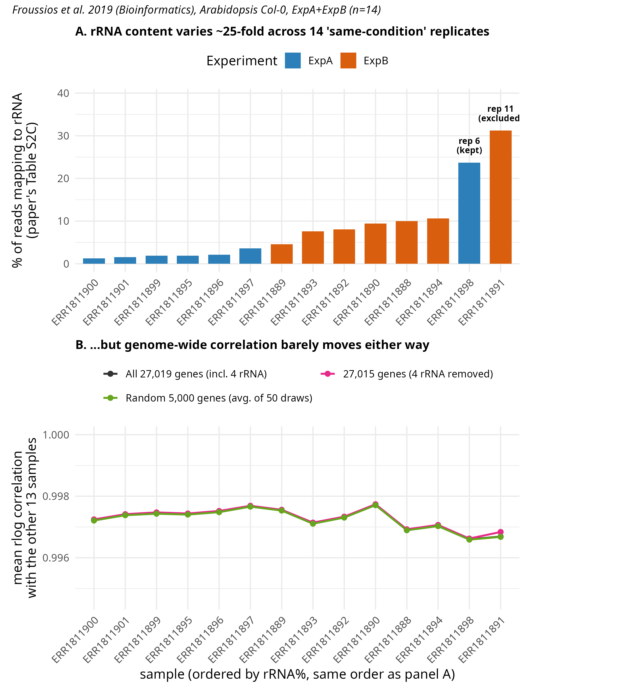

# 02 rRNA fraction vs. genome-wide correlation

| | |
|---|---|
| **Aim** | Can a genome-wide sample-to-sample correlation reveal that replicates differ in rRNA content? |
| **Input** | Gene counts (`pipeline_data/STAR_both/fC/`), rRNA counts (`pipeline_data/rRNA_qc/counts/`), published rRNA % ([`data/paper_TableS2C_rRNA.csv`](../data/paper_TableS2C_rRNA.csv)); 14 ExpA/ExpB samples. |
| **Scripts** | [`02a_rRNA_correlation.R`](scripts/02a_rRNA_correlation.R) / [`.py`](scripts/02a_rRNA_correlation.py) |
| **Assumptions** | The published rRNA fractions are correct. The 4 rRNA rows from `00d` carry almost no rRNA signal (undercount, topic 00), so the "incl. / without rRNA" comparison does not test removing 31% rRNA; the result rests on the published fractions vs. the correlation level. |
| **Statistical approach** | DESeq2 rlog (`blind = TRUE`); per sample, mean Pearson correlation with the other 13, on all genes, without the 4 rRNA rows, and on 5,000 random genes (mean of 50 draws). Python: pydeseq2 vst instead of rlog. |
| **Output** | [`figure02a_rRNA_vs_correlation.png`](results/figure02a_rRNA_vs_correlation.png); post: [`post02.txt`](results/post02.txt). |
| **Conclusion** | rRNA ranges from 1.26% to 31.21% (about 25-fold) across the 14 replicates, yet every sample has a mean correlation of about 0.997 with the others. A high correlation does not show equal library composition; the rRNA fraction has to be measured directly. |

