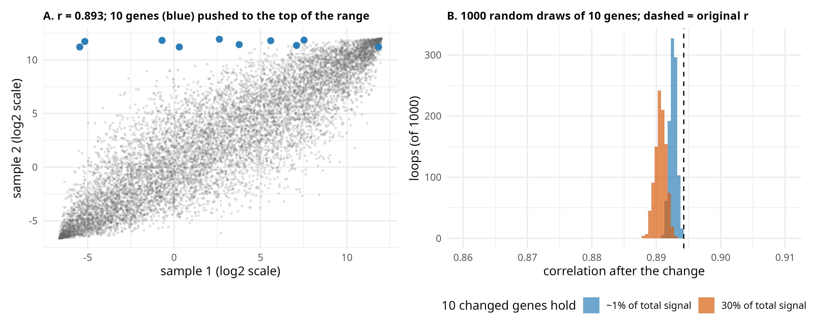

# 03 A few extreme genes barely move a correlation

| | |
|---|---|
| **Aim** | Why can 30% of a library almost disappear from a correlation? |
| **Input** | None (simulation). |
| **Scripts** | [`03a_simulation.R`](scripts/03a_simulation.R) / [`.py`](scripts/03a_simulation.py) |
| **Assumptions** | Two samples of 10,000 genes on the log2 scale (log2(0.01) to 12), correlation about 0.9 (real replicates: about 0.997), values spread uniformly via a Gaussian copula; only the 10 changed genes are altered. |
| **Statistical approach** | 1,000 loops; each moves 10 random genes either to the top of the range (about 1% of the linear-scale total) or to 30% of the linear-scale total; Pearson r recomputed each time. |
| **Output** | [`figure03a_compositional_shift.png`](results/figure03a_compositional_shift.png); post: [`post03.txt`](results/post03.txt). |
| **Conclusion** | Baseline r = 0.894; with 1% of the signal r = 0.891-0.894, with 30% r = 0.888-0.893. Ten points out of 10,000 hardly move r, and rescaling all other genes is a constant log2 shift that r ignores. Correlation measures similarity of expression patterns, not of library composition. |

