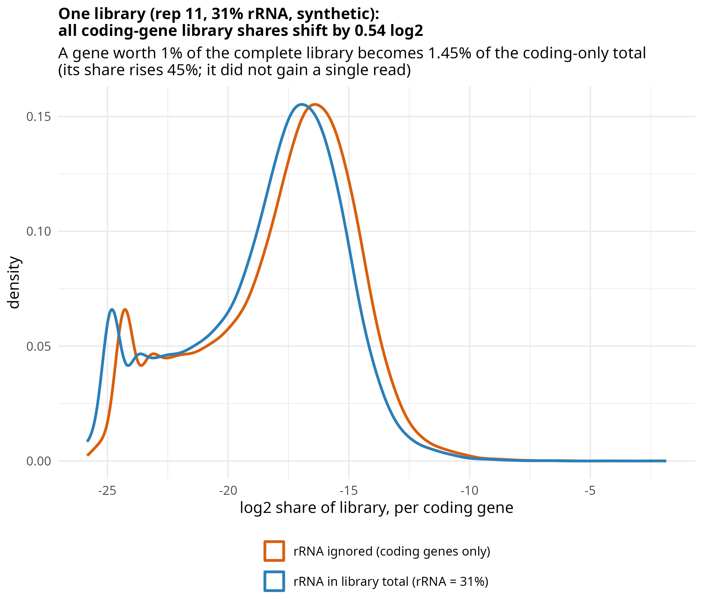

# 04 What does an omitted feature do to library shares?

| | |
|---|---|
| **Aim** | If 31% of a library is rRNA but rRNA never enters the count matrix, what happens to the coding genes? |
| **Input** | Gene counts (`pipeline_data/STAR_both/fC/`), replicate 11; published rRNA % ([`data/paper_TableS2C_rRNA.csv`](../data/paper_TableS2C_rRNA.csv)). |
| **Scripts** | [`04a_rRNA_ignored.R`](scripts/04a_rRNA_ignored.R) / [`.py`](scripts/04a_rRNA_ignored.py) |
| **Assumptions** | Synthetic two-component model: library = counted coding genes + rRNA; rRNA total = coding total × p / (1 − p) with p the published fraction. Not a reconstruction of real rRNA counts; unassigned, multimapping and other non-coding reads are ignored. |
| **Statistical approach** | Per coding gene, log2 share of the library with and without the synthetic rRNA total in the denominator; density of both. |
| **Output** | [`figure04a_rRNA_ignored.png`](results/figure04a_rRNA_ignored.png); post: [`post04.txt`](results/post04.txt). |
| **Conclusion** | Leaving out 31.21% rRNA shifts every coding gene's share by log2(1/(1 − p)) = 0.54: a gene at 1% of the full library becomes 1.45% of the coding-only total without gaining a read. The shift is sample-specific (it scales with each sample's rRNA fraction), so total-count normalization is directly exposed to it; median-of-ratios should not be. |

