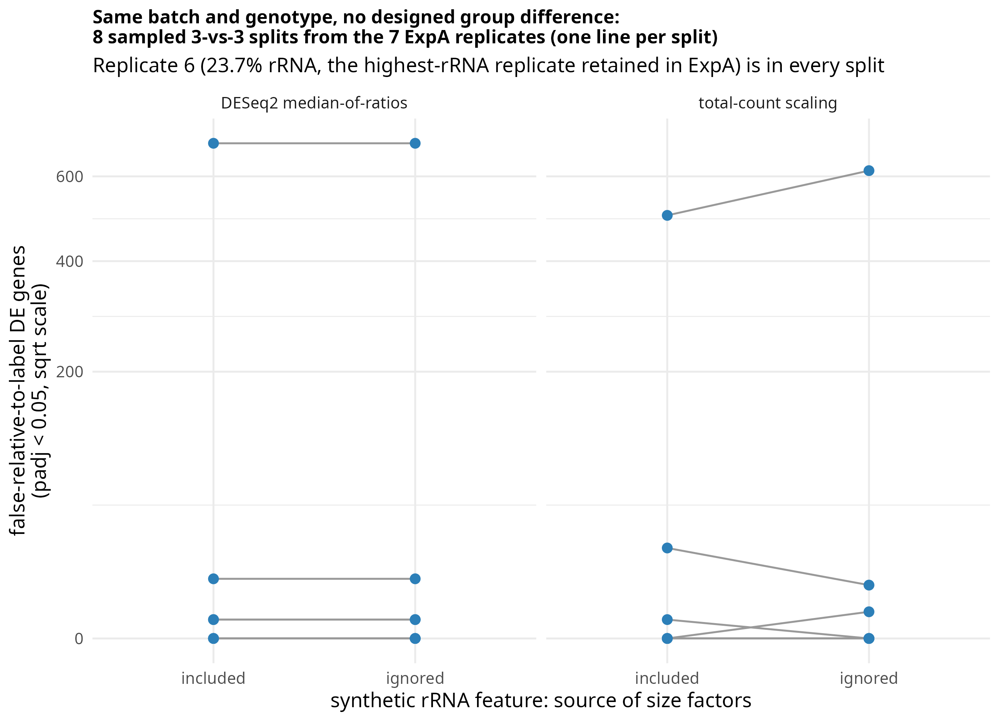

# 05 Can normalization choice change false-DE counts?

| | |
|---|---|
| **Aim** | Does the different sensitivity of total-count scaling and median-of-ratios to an omitted dominant feature (topic 04) change DE calls? |
| **Input** | Gene counts (`pipeline_data/STAR_both/fC/`), 7 ExpA replicates; published rRNA % ([`data/paper_TableS2C_rRNA.csv`](../data/paper_TableS2C_rRNA.csv)). |
| **Scripts** | [`05a_false_DE_by_normalization.R`](scripts/05a_false_DE_by_normalization.R) / [`.py`](scripts/05a_false_DE_by_normalization.py) · [`05b_series_summary_slide.py`](scripts/05b_series_summary_slide.py) |
| **Assumptions** | Same genotype and batch, so every `padj < 0.05` call is false relative to the labels. Synthetic rRNA row as in topic 04, used only for size factors; DE is always tested on the same coding-only matrix. Replicate 6 (23.7% rRNA, the highest-rRNA replicate retained in ExpA) is in group 2 of every split. |
| **Statistical approach** | 8 of the 60 possible 3-vs-3 splits (`set.seed(1)`; group 1 vs. group 2 by replicate: 4,1,5 vs 6,2,7; 2,3,4 vs 6,1,5; 3,7,1 vs 6,2,4; 3,5,7 vs 6,1,2; 2,7,5 vs 6,1,3; **2,1,3 vs 6,4,5 (split 6)**; 2,7,4 vs 6,3,5; 2,5,7 vs 6,1,4). Size factors: median-of-ratios or total-count scaling, each with and without the rRNA row. DESeq2 `~group`, Wald test, `padj < 0.05`. Python: pydeseq2. |
| **Output** | [`table05a_false_DE_counts.csv`](results/table05a_false_DE_counts.csv), [`figure05a_false_DE_by_normalization.png`](results/figure05a_false_DE_by_normalization.png); post: [`post05.txt`](results/post05.txt). Post 5.5 (series summary): [`post05.5_series_summary.txt`](results/post05.5_series_summary.txt), [`figure05b_post05.5_summary_slide.png`](results/figure05b_post05.5_summary_slide.png), [`figure05c_post05.5_QC_decisions_slide.pdf`](results/figure05c_post05.5_QC_decisions_slide.pdf). |
| **Conclusion** | Median-of-ratios: identical DE counts with and without the rRNA row in 8 of 8 splits. Total-count scaling: different in 4 of 8, both directions (23 → 8, 0 → 2, 1 → 0, 503 → 615). Split 6 gives 503-689 DE genes under every treatment: structure already in the gene counts (topic 06). |

