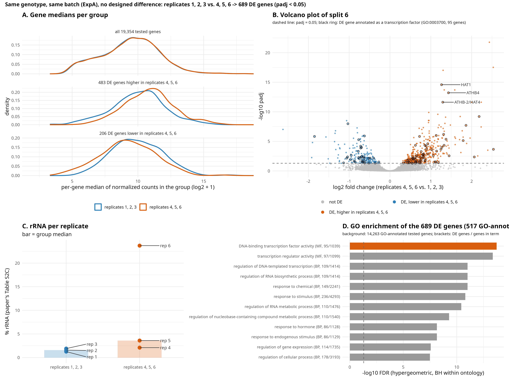

# 06 Why does one same-batch 3-vs-3 split give 689 DE genes?

| | |
|---|---|
| **Aim** | Split 6 (replicates 1, 2, 3 vs. 4, 5, 6 of ExpA) gives hundreds of DE genes with no designed difference. Is it rRNA, one replicate, or structure shared by the replicates? |
| **Input** | Gene counts (`pipeline_data/STAR_both/fC/`), 7 ExpA replicates; published rRNA %; GO annotation (TAIR GAF and `go-basic.obo` from the GO Consortium, downloaded to `pipeline_data/GO_annotation/`; release 2026-05/07). |
| **Scripts** | [`06a_split_structure.R`](scripts/06a_split_structure.R) / [`.py`](scripts/06a_split_structure.py) · [`06b_volcano_GOEA.R`](scripts/06b_volcano_GOEA.R) / [`.py`](scripts/06b_volcano_GOEA.py) · [`06c_post6_figures.R`](scripts/06c_post6_figures.R) / [`.py`](scripts/06c_post6_figures.py) |
| **Assumptions** | DESeq2 defaults (median-of-ratios; topic 05 showed the rRNA row does not change this split). Replicate numbering is the paper's; whether it reflects processing order is not documented. Harvest time, plate and extraction metadata are not available. |
| **Statistical approach** | DESeq2 `~group`, Wald, `padj < 0.05`. All 70 distinct 3-vs-3 splits of ExpA; Spearman correlation of DE count with the groups' log rRNA separation. PCA (vst, 500 most variable genes). Leave-one-out and swap variants of split 6. GO enrichment: annotations propagated to ancestors, hypergeometric test against the 14,263 GO-annotated tested genes, terms ≥ 5 genes, BH within ontology. STRING/InterPro check of the 8 genes with `padj < 0.05` and apeglm-shrunken \|log2FC\| > 2. Python: pydeseq2. |
| **Output** | [`table06a_split6_DE_genes.csv`](results/table06a_split6_DE_genes.csv), [`table06b_all_70_splits.csv`](results/table06b_all_70_splits.csv), [`table06c_GO_enrichment_split6.csv`](results/table06c_GO_enrichment_split6.csv), [`table06d_STRING_top8_genes.txt`](results/table06d_STRING_top8_genes.txt); [`figure06a_split_structure.png`](results/figure06a_split_structure.png) (medians, rRNA), [`figure06b_split_structure_4panels.png`](results/figure06b_split_structure_4panels.png) (+ volcano, GO); posts 6A-6D: [`figure06c_post6A_volcano.png`](results/figure06c_post6A_volcano.png), [`figure06d_post6B_rRNA_swap.png`](results/figure06d_post6B_rRNA_swap.png), [`figure06e_post6C_PCA.png`](results/figure06e_post6C_PCA.png), [`figure06f_post6D_GO.png`](results/figure06f_post6D_GO.png). |
| **Conclusion** | 689 DE genes (483 up, 206 down), mostly modest (median \|log2FC\| 0.71; 549 under 2-fold). PC1 (64%) orders the replicates almost by number (1, 2, 3, 4, 5, 7, 6); splits crossing that gradient give hundreds to 1,600 DE genes, mixed splits almost none (median of 70: 4). Not rRNA: swapping replicate 6 (23.7%) for 7 (1.87%) raises the count to 1,389, mixing (1, 2, 7 vs. 4, 5, 6) gives 5, and DE count does not track rRNA separation (rho = −0.12), although rRNA rises along PC1 (rho = 0.79, replicate 7 the exception). Top GO term: DNA-binding transcription factor activity (95 of 1,039 genes, 2.5-fold, FDR 1.9e-14; holds after adjusting for expression), with light/shade HD-ZIP II genes (ATHB-2, HAT1, ATHB4) on top: a significant TF term can arise from unrecorded structure among replicates. Harvest time or light is a hypothesis, not a result. |
| **References** | Schurch et al. 2016, *RNA* 22:839 (doi:10.1261/rna.053959.115); Birchler & Veitia 2012, *PNAS* 109:14746; McCarthy & Smyth 2009, *Bioinformatics* 25:765. |

