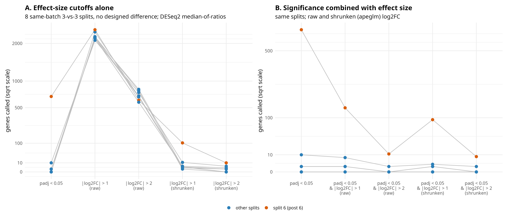

# 07 Significance vs. effect size

| | |
|---|---|
| **Aim** | How many genes does each common DE rule call when there is no designed difference? |
| **Input** | Gene counts (`pipeline_data/STAR_both/fC/`), 7 ExpA replicates; published rRNA %. |
| **Scripts** | [`07a_effect_size.R`](scripts/07a_effect_size.R) / [`.py`](scripts/07a_effect_size.py) |
| **Assumptions** | Same 8 splits, synthetic rRNA row and 4 size-factor treatments as topic 05; DE always tested on the coding-only matrix. |
| **Statistical approach** | DESeq2 `~group`. Ten rules: `padj < 0.05`; raw (MLE) \|log2FC\| > 1 / > 2; apeglm-shrunken \|log2FC\| > 1 / > 2; `padj < 0.05` combined with each of the four; `results(lfcThreshold = 1)` (H0: \|log2FC\| ≤ 1). Python: pydeseq2 (`lfc_shrink`, `lfc_null = 1`). |
| **Output** | [`table07a_effect_size_counts.csv`](results/table07a_effect_size_counts.csv) (genes per split, treatment, rule), [`table07b_log2FC_shift.csv`](results/table07b_log2FC_shift.csv) (log2FC shift when the rRNA row is ignored), [`table07c_raw_log2FC_expression.csv`](results/table07c_raw_log2FC_expression.csv) (expression of genes passing a raw cutoff), [`figure07a_effect_size.png`](results/figure07a_effect_size.png) (median-of-ratios only). |
| **Conclusion** | Raw fold-change cutoffs alone call 2,098-2,448 (> 1) and 589-826 (> 2) genes per split, almost all with a handful of reads (median baseMean 0.7-0.9). Rules that account for uncertainty call far fewer: shrunken > 1: 1-102; `padj` & raw > 1: 0-140; `padj` & shrunken > 1: 0-93; `lfcThreshold = 1`: 0-3. Split 6 is the outlier under every such rule. Under total-count scaling, ignoring the rRNA row shifts every log2FC by about 0.1, which changes raw-cutoff counts in all 8 splits; under median-of-ratios the shift is about 1e-6. Report the DE rule with the DE count. |

