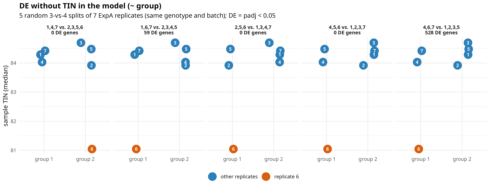
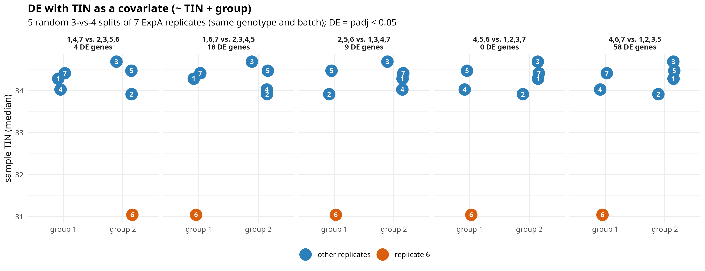

# 08 Hidden degradation: does RNA integrity explain false DE within ExpA?

| | |
|---|---|
| **Aim** | Measure RNA degradation (transcript integrity number, TIN) in the 7 ExpA replicates; test whether it tracks rRNA % or singleton reads, and whether it causes false DE between replicate groups, especially when the degraded sample sits in an unbalanced (3 vs. 4) group. |
| **Input** | Paired-end BAMs of [`00c`](../00_preprocessing/scripts/00c_trim_star_featurecounts.sh) (`pipeline_data/STAR_both/`); TIN per transcript from RSeQC `tin.py` (`pipeline_data/TIN/`); STAR logs of the paired, forward-only and reverse-only alignments (`pipeline_data/STAR_*/`); gene counts (`pipeline_data/STAR_both/fC/`); published rRNA % ([`data/paper_TableS2C_rRNA.csv`](../data/paper_TableS2C_rRNA.csv)). |
| **Scripts** | [`08a_tin_cluster.sh`](scripts/08a_tin_cluster.sh) (cluster job: BED12 from GFF3, `tin.py` per BAM; also rule `tin` in [`workflow/Snakefile`](../workflow/Snakefile)) · [`08b_degradation_metrics.R`](scripts/08b_degradation_metrics.R) / [`.py`](scripts/08b_degradation_metrics.py) · [`08c_DE_with_without_TIN.R`](scripts/08c_DE_with_without_TIN.R) / [`.py`](scripts/08c_DE_with_without_TIN.py). `EXCLUDE_REPS=6` repeats 08b and 08c without replicate 6 (output in [`results/without_rep6/`](results/without_rep6/)). |
| **Assumptions** | Sample TIN = median TIN over transcripts with TIN > 0. Singletons = reads whose mate was removed by trimming (forward-only + reverse-only STAR input reads, % of all fragments). All 7 replicates are the same genotype and batch, so every DE gene is false. |
| **Statistical approach** | Spearman and Pearson correlation (n = 7). DESeq2 on all 35 3-vs-4 splits (without replicate 6: 10 unique 3-vs-3 splits), `~ group` vs. `~ TIN + group` (sample TIN, centred, as a continuous covariate), Wald, `padj < 0.05`; 5 splits drawn at random (`set.seed(8)`) for figures d and e. Python: pydeseq2. |
| **Output** | [`table08a_degradation_metrics.csv`](results/table08a_degradation_metrics.csv), [`table08b_correlations.csv`](results/table08b_correlations.csv), [`table08c_DE_all_splits.csv`](results/table08c_DE_all_splits.csv), [`table08d_DE_5_random_splits.csv`](results/table08d_DE_5_random_splits.csv); [`figure08a_TIN_per_sample.png`](results/figure08a_TIN_per_sample.png), [`figure08b_TIN_vs_rRNA.png`](results/figure08b_TIN_vs_rRNA.png), [`figure08c_TIN_vs_singletons.png`](results/figure08c_TIN_vs_singletons.png), [`figure08d_splits_without_TIN.png`](results/figure08d_splits_without_TIN.png), [`figure08e_splits_with_TIN.png`](results/figure08e_splits_with_TIN.png), [`figure08f_DE_vs_TIN_imbalance.png`](results/figure08f_DE_vs_TIN_imbalance.png); same set in [`results/without_rep6/`](results/without_rep6/). |
| **Conclusion** | Replicate 6 has the lowest TIN (81.0; others 83.9-84.7), so its degradation is real but mild. TIN vs. rRNA: Pearson r = −0.97 (p = 0.0004) but Spearman rho = −0.11; without replicate 6, r = 0.31 (p = 0.54). One sample carries the whole correlation. TIN vs. singletons: no relation (rho = −0.21); singletons split the replicates into 1, 2, 5, 6 (18-23%) and 3, 4, 7 (5-8%). False DE does not follow TIN: the median over 35 splits is 2 DE genes (4 with TIN in the model), and the big splits (up to 1,423 genes) are the 1, 2, 3 vs. rest structure of topic 06. Placing replicate 6 in the smaller group does not raise the median (0 vs. 3). The TIN covariate removes false DE in some splits (528 → 58) and adds it in others (65 → 928). Without replicate 6, the 3-vs-3 split 1, 2, 3 vs. 4, 5, 7 still gives 1,389 DE genes. In this dataset, mild degradation of one sample is not what produces false DE. With n = 7 and a TIN range of 3.7 units, these tests have little power. |

Topics 09 and 10 also need TIN for ExpB: `EXPERIMENTS="ExpA ExpB" sbatch --export=ALL 08_hidden_degradation/scripts/08a_tin_cluster.sh`.

