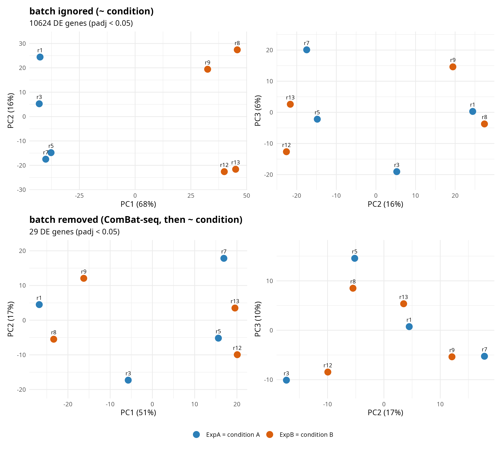
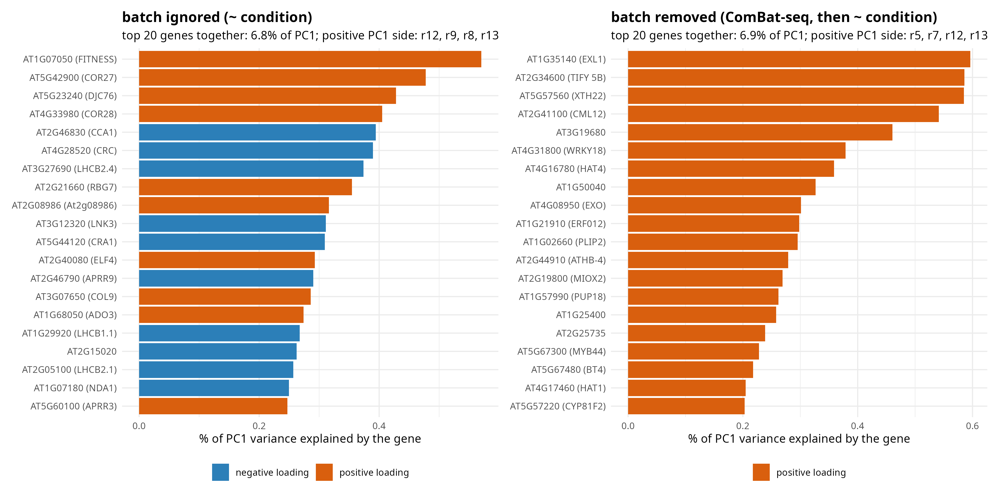

# 09 When batch = condition

| | |
|---|---|
| **Aim** | Show what happens when the batch is the condition: the 4 ExpA replicates with the highest TIN are called condition A, and the 4 ExpB replicates with the highest TIN are called condition B. All 8 are Col-0 wild type. |
| **Input** | Gene counts (`pipeline_data/STAR_both/fC/`) of ExpA replicates 1, 3, 5, 7 and ExpB replicates 8, 9, 12, 13 (TIN from [`08a`](../08_hidden_degradation/scripts/08a_tin_cluster.sh) with `EXPERIMENTS="ExpA ExpB"`); GO annotation as in topic 06 ([`lib/go_enrichment.R`](../lib/go_enrichment.R) / [`.py`](../lib/go_enrichment.py)). |
| **Scripts** | [`09a_batch_equals_condition.R`](scripts/09a_batch_equals_condition.R) / [`.py`](scripts/09a_batch_equals_condition.py); Shiny app [`app/app.R`](app/app.R) / [`app/app.py`](app/app.py). |
| **Assumptions** | Genes with ≥ 10 reads in at least 4 of the 8 samples (21,746). Model 1 ignores the batch. Model 2 removes it: DESeq2 `~ batch + condition` is not estimable (the two columns are identical), and ComBat-seq refuses condition as a covariate ("confounded with batch"), so ComBat-seq is run with the batch only, then DESeq2 `~ condition`. |
| **Statistical approach** | DESeq2 Wald, `padj < 0.05`. GO enrichment (hypergeometric, BH within ontology, universe = the 21,746 genes) of DE genes with \|log2FC\| > 1 and of the 20 genes contributing most to PC1. PCA on the blind vst of all 21,746 genes; correlation of PC1-3 scores with batch (Pearson, batch coded 0/1); gene contribution = squared loading in % (contributions of all genes to one PC sum to 100%). Python: pydeseq2 and inmoose `pycombat_seq`. |
| **Output** | [`table09a_samples.csv`](results/table09a_samples.csv), [`table09b_confounded_designs.csv`](results/table09b_confounded_designs.csv), per model (`batch_ignored`, `batch_removed`): `table09c_DE_genes_*`, `table09d_GO_DE_genes_*`, `table09e_top20_PC1_genes_*`, `table09f_GO_top20_PC1_*`; [`table09g_PC_batch_correlation.csv`](results/table09g_PC_batch_correlation.csv), [`table09h_DE_counts.csv`](results/table09h_DE_counts.csv); [`figure09a_PCA.png`](results/figure09a_PCA.png), [`figure09b_PC_batch_correlation.png`](results/figure09b_PC_batch_correlation.png), [`figure09c_top20_PC1_contributions.png`](results/figure09c_top20_PC1_contributions.png), [`figure09d_GO.png`](results/figure09d_GO.png); app tables in [`results/app_data/`](results/app_data/). |
| **Conclusion** | Batch ignored: 10,624 of 21,744 genes DE (49%; 2,682 with \|log2FC\| > 1). PC1 (68%) is the batch (r = 0.995). Its top genes are clock genes (CCA1, PRR9, PRR3, LNK3, ELF4, COR27, COR28; GO "circadian rhythm", FDR 6e-8), so the batch looks like biology, probably harvest at different times of day. The DE genes are enriched for RNA modification, light harvesting and circadian rhythm: a convincing GO story for a difference that is not biological. Batch removed: 29 DE genes, all with zero counts in one batch (ComBat-seq cannot adjust a gene that is absent from a batch); PC1-3 are no longer related to batch (\|r\| < 0.004). Removing the batch removes every A-vs-B difference: a real treatment effect would go with it. **When condition = batch, no design or correction separates them: the only fix is a balanced design, with each condition in each batch.** |

Shiny app (three sections: data structure, gene search with TAIR link, analysis with PCA, top-20 PC gene lists, STRING links and DE list), run from the repository root:

```bash
Rscript -e 'shiny::runApp("09_batch_equals_condition/app", launch.browser = TRUE)'
shiny run 09_batch_equals_condition/app/app.py --launch-browser       # pip install shiny faicons
```



