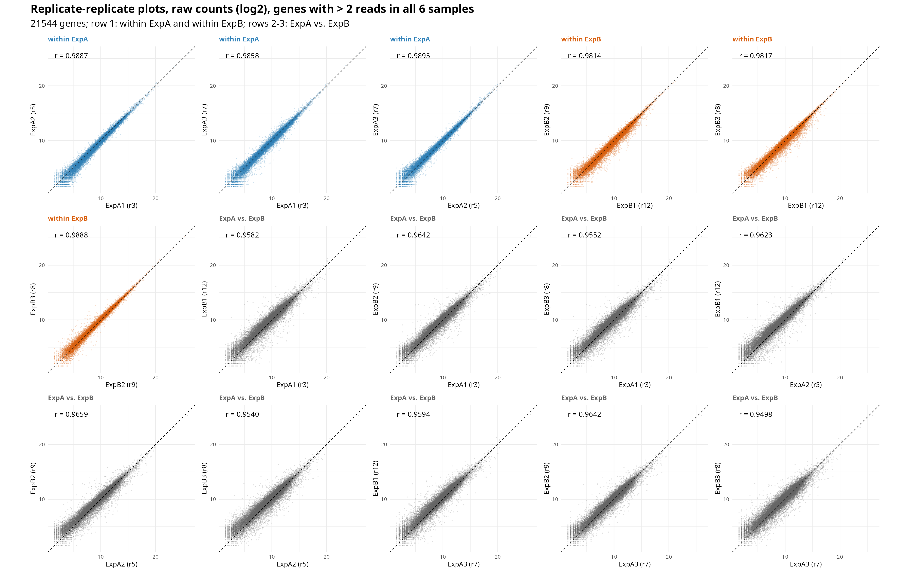
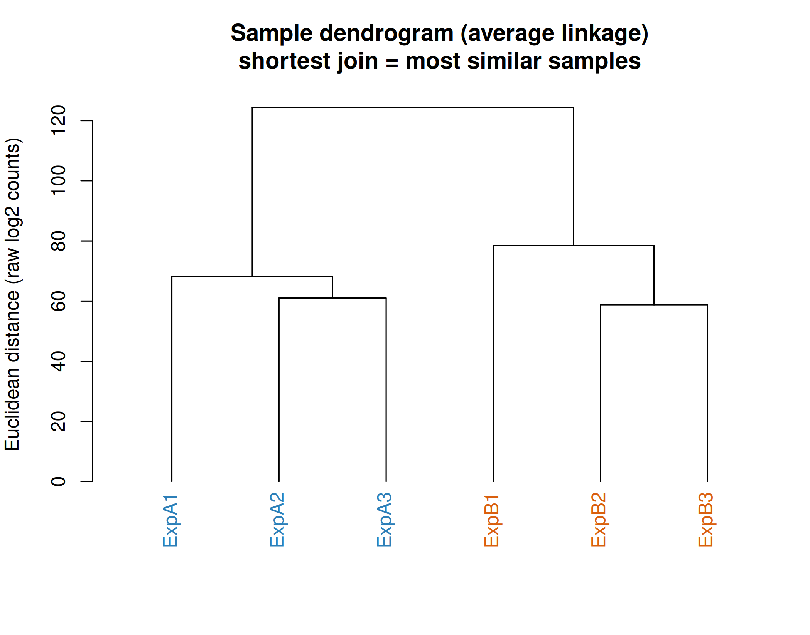

# 10 Mislabelling: one swapped sample per group

| | |
|---|---|
| **Aim** | Show what a sample swap does to DE, and how sample-level QC exposes it. ExpA and ExpB are treated as two conditions (batch ignored on purpose). |
| **Input** | Gene counts (`pipeline_data/STAR_both/fC/`) of the 3 ExpA and 3 ExpB replicates with the highest TIN: ExpA1-3 = replicates 3, 5, 7; ExpB1-3 = replicates 12, 9, 8 (TIN from [`08a`](../08_hidden_degradation/scripts/08a_tin_cluster.sh) with `EXPERIMENTS="ExpA ExpB"`). |
| **Scripts** | [`10a_mislabelling.R`](scripts/10a_mislabelling.R) / [`.py`](scripts/10a_mislabelling.py) |
| **Assumptions** | Mislabelled: group 1 = ExpA1, ExpA2, ExpB3; group 2 = ExpB1, ExpB2, ExpA3. Correct: ExpA1-3 vs. ExpB1-3. No batch term (we pretend there is no batch effect). |
| **Statistical approach** | DESeq2 `~ group`, Wald, `padj < 0.05`. Sample QC on raw counts of genes with > 2 reads in all 6 samples (21,544 genes), log2: replicate-replicate plots of all 15 pairs (3 within ExpA, 3 within ExpB, 9 across) with Pearson r; Pearson correlation matrix; dendrogram of Euclidean distances (average linkage). Python: pydeseq2, scipy. |
| **Output** | [`table10a_samples.csv`](results/table10a_samples.csv), [`table10b_DE_counts.csv`](results/table10b_DE_counts.csv), [`table10c_DE_genes_mislabelled.csv`](results/table10c_DE_genes_mislabelled.csv), [`table10d_DE_genes_correct.csv`](results/table10d_DE_genes_correct.csv), [`table10e_pairwise_correlation.csv`](results/table10e_pairwise_correlation.csv), [`table10f_correlation_matrix.csv`](results/table10f_correlation_matrix.csv); [`figure10a_RR_plots.png`](results/figure10a_RR_plots.png), [`figure10b_correlation_matrix.png`](results/figure10b_correlation_matrix.png), [`figure10c_dendrogram.png`](results/figure10c_dendrogram.png), [`figure10d_DE_counts.png`](results/figure10d_DE_counts.png). |
| **Conclusion** | Correct labels: 9,270 DE genes (3,401 with \|log2FC\| > 1; Python 8,713). One swapped sample per group: **0** DE genes. A single swap in a 3-vs-3 design hides an effect that touches a third of the genome. Here the "effect" is the ExpA/ExpB batch, so the swap happens to hide a false result, but a real treatment effect would vanish the same way. QC on raw counts shows the swap before any test: within-experiment r = 0.981-0.990, across experiments 0.950-0.966, and the dendrogram joins ExpA1-3 and ExpB1-3 into two clean clusters that cut across the labelled groups. Check that samples cluster by their labels before running DE. |

