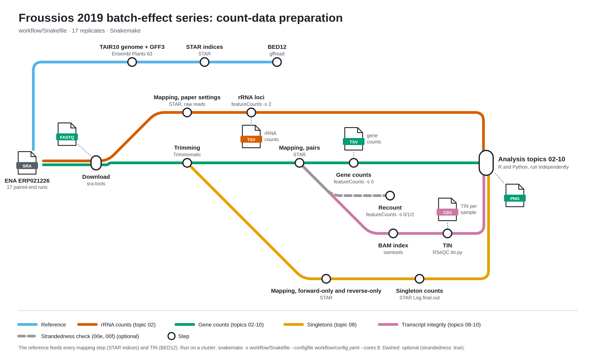

# Froussios et al. 2019 – batch-effect series

A teaching case for batch effects and QC in RNA-seq, built on the openly available data of
Froussios et al. 2019 (*Bioinformatics* 35(18):3372, doi:10.1093/bioinformatics/btz089;
ArrayExpress E-MTAB-5446, ENA ERP021226; open access, CC BY 4.0): 17 biological replicates of
*Arabidopsis thaliana* Col-0 from three experiments, one growth condition. It is not a critique of
the original study, which benchmarked differential-expression tools. Each topic belongs to one
LinkedIn post (or a few).

## Layout
```
NN_topic/        one folder per topic
  README.md        one table: aim, input, scripts, assumptions, statistical approach, output, conclusion
  scripts/         NNa_, NNb_, ... in run order; every .R has a .py equivalent
  results/         tables tableNNx_*, figures figureNNx_*, post texts postNN*.txt;
                   results/python/ holds the outputs of the Python versions
data/            run list, replicate numbering, paper's rRNA fractions (Table S2C)
lib/             shared code (GO enrichment, R and Python)
workflow/        Snakemake workflow for the count-data preparation, its config and subway map
publication/     paper PDF and Supplementary Table S2
config.sh        shared paths and threads for the shell scripts (override with environment variables)
pipeline_data/   not in git: reads, reference, BAMs, counts, TIN, STAR logs, GO annotation
```

## Topics
| Topic | Question |
|---|---|
| [00](00_preprocessing/README.md) | reads to gene and rRNA counts; strandedness check |
| [01](01_paper_and_dataset/README.md) | the paper and the dataset (posts 1, 6.5) |
| [02](02_rRNA_correlation/README.md) | does genome-wide correlation reveal rRNA content? |
| [03](03_compositional_shift/README.md) | why a few extreme genes barely move a correlation (simulation) |
| [04](04_rRNA_ignored/README.md) | what an omitted feature does to library shares |
| [05](05_normalization_false_DE/README.md) | can normalization choice change false-DE counts? (posts 5, 5.5) |
| [06](06_split_structure/README.md) | why one same-batch 3-vs-3 split gives 689 DE genes (posts 6A-6D) |
| [07](07_effect_size/README.md) | significance vs. effect size as DE rules |
| [08](08_hidden_degradation/README.md) | hidden degradation: does RNA integrity (TIN) explain false DE within ExpA? |
| [09](09_batch_equals_condition/README.md) | when batch = condition (4 vs. 4), with a Shiny app in R and Python |
| [10](10_mislabelling/README.md) | mislabelling: one swapped sample per group |

Folders and posts at a glance: [`ROADMAP.md`](ROADMAP.md).

## Run order

**1. Count-data preparation (scripts `00a`-`00e` and `08a`): run once, in this order.** These steps
need the cluster (17 runs of about 100 million read pairs) and produce everything in `pipeline_data/` that
the analyses read. They are also available as one Snakemake workflow, which runs the same commands
and settings and resumes where it stopped:
```bash
snakemake -s workflow/Snakefile --configfile workflow/config.yaml --cores 8     # add --executor slurm on a cluster
```
or step by step:
```bash
bash 00_preprocessing/scripts/00a_download_sra.sh                                               # FASTQ
bash 00_preprocessing/scripts/00b_prep_reference.sh                                             # TAIR10, STAR index
ADAPTERS=/path/to/TruSeq3-PE.fa bash 00_preprocessing/scripts/00c_trim_star_featurecounts.sh   # trimming, mapping, gene counts
bash 00_preprocessing/scripts/00d_count_rRNA.sh                                                 # rRNA counts
bash 00_preprocessing/scripts/00e_count_strandedness.sh                                         # optional: -s 0/1/2 recount
EXPERIMENTS="ExpA ExpB" bash 08_hidden_degradation/scripts/08a_tin_cluster.sh                  # TIN (also: sbatch)
```



The map is drawn with [slitherFlow](https://github.com/mikemartinez99/slitherFlow) from
[`workflow/subway_map.yaml`](workflow/subway_map.yaml): `slitherflow render workflow/subway_map.yaml -o workflow/subway_map.svg --png`.

**2. Analyses (topics 02-10): run independently, in any order**, once `pipeline_data/` exists. Each topic
script reads only `pipeline_data/`, `data/` and `lib/`; within a topic, run the scripts in letter order
(`NNa`, `NNb`, ...).
```bash
Rscript 00_preprocessing/scripts/00f_strandedness_comparison.R   # optional, after 00e
Rscript 02_rRNA_correlation/scripts/02a_rRNA_correlation.R
Rscript 03_compositional_shift/scripts/03a_simulation.R           # needs no data
Rscript 04_rRNA_ignored/scripts/04a_rRNA_ignored.R
Rscript 05_normalization_false_DE/scripts/05a_false_DE_by_normalization.R
python3 05_normalization_false_DE/scripts/05b_series_summary_slide.py
Rscript 06_split_structure/scripts/06a_split_structure.R           # then 06b, 06c
Rscript 07_effect_size/scripts/07a_effect_size.R
Rscript 08_hidden_degradation/scripts/08b_degradation_metrics.R    # then 08c; EXCLUDE_REPS=6 for both without replicate 6
Rscript 09_batch_equals_condition/scripts/09a_batch_equals_condition.R
Rscript 10_mislabelling/scripts/10a_mislabelling.R
```
Every `.R` script has a `.py` equivalent with the same name (`python3 NN_topic/scripts/NNx_name.py`),
writing to `NN_topic/results/python/`. Shiny apps: see [topic 09](09_batch_equals_condition/README.md).

**Requirements.** sra-tools, Trimmomatic, STAR, Subread (featureCounts), samtools, gffread, RSeQC.
Snakemake (optional). R: DESeq2, sva, ggplot2, patchwork, MASS, ggrepel, apeglm, shiny, bslib, DT. Python: numpy, pandas,
scipy, statsmodels, matplotlib, pydeseq2, inmoose, shiny, faicons (e.g. in a virtual environment:
`python3 -m venv .venv && .venv/bin/pip install pydeseq2 inmoose shiny faicons statsmodels matplotlib`).
Steps in `00` and `08a` skip outputs that already exist. Topics 02-05 run in a minute or two, 06, 08
and 09 in a few minutes (`THREADS` sets cores), 07 in about 15 minutes (R) or longer (Python).

**R vs. Python.** The Python versions use pydeseq2, which is not numerically identical to DESeq2:
DE counts differ by a few percent (split 6: 708-709 vs. 689 genes; topic 10 correct grouping:
8,713 vs. 9,270), and pydeseq2 has no rlog (topics 00 and 02 use vst). ComBat-seq (sva vs. inmoose)
differs slightly as well (topic 09 after correction: 14 vs. 29 genes). Splits are the same in both
languages; simulations use different random generators.

## Data
`pipeline_data/` (or `$PIPELINE_DIR`) is regenerated from public sources by the `00` and `08a` scripts: `fastq/`
(17 runs), `ref/` (TAIR10, Ensembl Plants 63, STAR index, BED12), `STAR_both/` (BAMs, gene counts in
`fC/`, used by topics 02-10), `STAR_Fonly/` and `STAR_Ronly/` (alignments of reads whose mate was
removed by trimming; their `Log.final.out` gives the singleton counts of topic 08), `rRNA_qc/counts/`
(4 rRNA loci, topic 02), `TIN/` (RSeQC `tin.py` output, topics 08-10). The GO annotation is
downloaded to `pipeline_data/GO_annotation/` on first use. Topic 03 needs no data.

ENA `sample_title` numbering differs from the paper's replicate numbering; use
[`data/replicate_map.tsv`](data/replicate_map.tsv) (replicate 11 = ERR1811891, replicate 6 = ERR1811898).

## Known limits
- `featureCounts -t gene` does not count the rRNA loci (typed `ncRNA_gene`); `00d` counts them
  separately but undercounts severely (replicate 11: about 0.006% vs. 31.21% published). Topics
  04, 05 and 07 therefore use a **synthetic** rRNA feature calibrated to the published fractions;
  they are sensitivity analyses, not reconstructions of real rRNA counts. Topic 08 uses the
  published fractions.
- The libraries are stranded (TruSeq Stranded Total RNA), but the gene counts are unstranded
  (`-s 0`) and count each mate of a pair (`-p` without `--countReadPairs`). The check
  (`00e`, `00f`) is prepared but not run.
